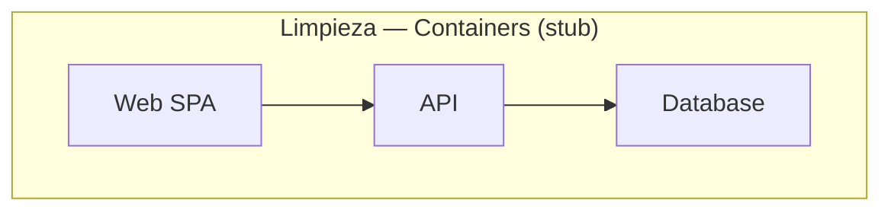

# Limpieza — C4 Containers

Container view for **Limpieza**: web app, API, data stores, and async workers.

- [ ] Name each container and its technology
- [ ] Document main protocols and dependencies
- [ ] Link to [c4-deployment.md](c4-deployment.md)
