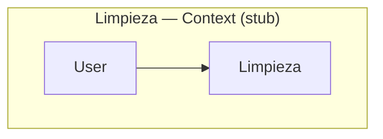

# Limpieza — C4 Context

System context for **Limpieza**: users, external systems, and the product boundary.

- [ ] List primary actors and external systems
- [ ] Describe scope of the product vs integrations
- [ ] Link to [c4-containers.md](c4-containers.md)
