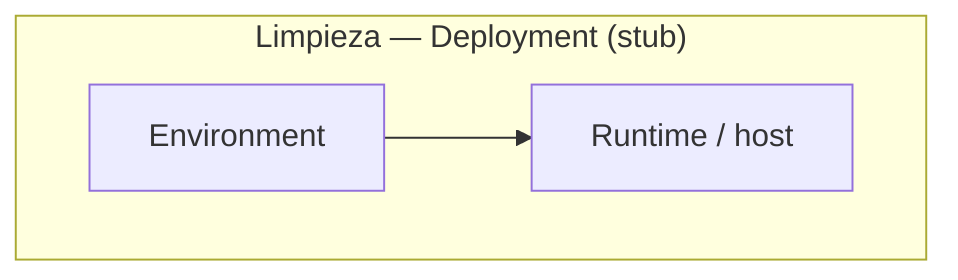

# Limpieza — C4 Deployment

Deployment view for **Limpieza**: environments, hosts, and network boundaries.

- [ ] Describe dev, staging, and production topology
- [ ] Note secrets, TLS, and ingress pattern
- [ ] Align with Compose / infra in backend and frontend repos
