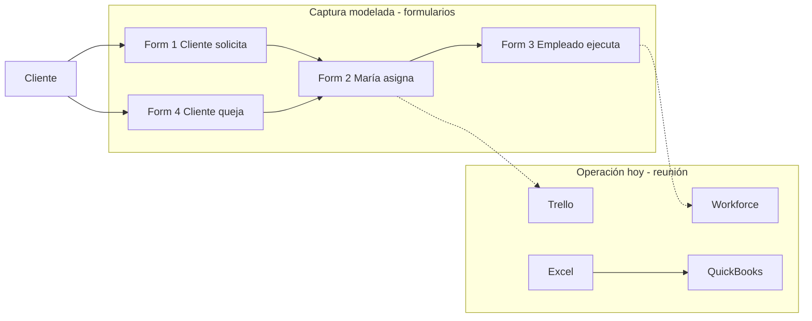
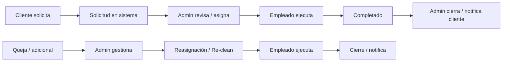

# Flujos actuales: operación de limpieza — Castivas Cleaning

Este documento describe **cómo opera / modela hoy su operación Castivas Cleaning** a partir de la reunión inicial y de los artefactos recibidos; **no describe un producto de software ya construido**.

Los cuatro formularios y el mapa de portal son **diseños de captura / wireframes** (marca Castivas, flujos digitales, PWA, geofence). Documentan el **lenguaje de dominio, campos, grano y roles** que el cliente usa para explicar el negocio. **No son evidencia de que hoy exista un portal en producción**; la operación actual sigue en Workforce, Trello, QuickBooks y Excel (reunión 8 oct 2026).

---

## 0. Alcance y contexto

| Tema | Detalle |
|------|---------|
| Cliente | Castivas Cleaning |
| Fuentes | [inputs/meetings/2026-10-08-reunion-inicial.md](../inputs/meetings/2026-10-08-reunion-inicial.md); [inputs/formularios/](../inputs/formularios/); [inputs/images/PHOTO-2026-09-29-19-12-49.jpg.jpeg](../inputs/images/PHOTO-2026-09-29-19-12-49.jpg.jpeg) |
| Quién briefó | Orlando Pineda describe la empresa; en formularios aparece **María / Operations** como rol de asignación |
| Volumen | ~150 empleados (transcripción). Clientes / servicios / mes: **no indicado** |
| Geografía | Manhattan Connect, Long Island, parte de New Jersey; «área de actividad estatal» |
| Equipo / roles | Cliente (p. ej. property management); María/Operations; empleado de campo; supervisores; contabilidad (QuickBooks) |
| Sistemas hoy | **Workforce**, **Trello**, **QuickBooks**, **Excel**; los PDF recibidos modelan el proceso deseado de captura |
| Dentro del alcance | Herramientas actuales; campos y flujos de los 4 formularios; jerarquía cliente→propiedad→edificio→unidad; catálogo de servicios; quejas; jornada del empleado |
| Fuera del alcance (to-be de producto, no ritual as-is medido) | Portal/PWA en producción, pasarela de pago, cotización automática, inventario (no aparece en estos formularios), modelo Uber de claim |
| Artefactos revisados | Ver [inputs/](../inputs/README.md): reunión, Formulario 1–4, foto mapa portal |
| Idiomas (confirmado) | La app debe estar en **inglés y español**; el usuario elige y el sistema **recuerda su preferencia** |

---

## 1. Sistemas, actores y origen de los datos

### Actores

| Actor | Evidencia | Qué hace |
|-------|-----------|----------|
| **Cliente** (compañía / property management) | Form. 1 y 4; ej. «ABC Property Management», contacto «Maria López» | Solicita servicio; reporta queja / solicitud adicional / re-clean |
| **María / Operations** | Form. 2 (rol explícito) | Revisa solicitud, usa sugerencias, asigna empleado, notifica |
| **Empleado de campo** | Form. 3; ej. «Ana García», «Carlos Pérez», «Jessica Torres» | Acepta, ejecuta, clock in/out, fotos, finaliza |
| **Supervisor** | Reunión; módulo en mapa portal | Visita trabajos; calificación (detalle de registro aún abierto) |
| **Contabilidad** | Reunión | QuickBooks (se mantiene; se le mandan datos) |

### Jerarquía de ubicación (grano)

```
Compañía / Cliente
 └── Propiedad          (ej. ABC Apartments)
      └── Edificio      (ej. Edificio 5)
           └── Apartamento / Unidad  (ej. 215)
```

Campos de tamaño del trabajo en la unidad: **número de habitaciones**, **número de baños**, **¿apartamento vacío?**

### Dónde nace la información

| Dato | Hoy (reunión) | Modelado en artefactos |
|------|---------------|------------------------|
| Solicitud de servicio | Canal as-is no confirmado (tel/WhatsApp/etc.) | Formulario 1 (cliente) |
| Asignación | Trello + admin manual | Formulario 2 (María/Operations) |
| Ejecución / tiempo en sitio | Workforce | Formulario 3 (empleado / PWA) |
| Quejas | PDF / proceso informal | Formulario 4 |
| Contabilidad | QuickBooks | No cubierto en estos 4 formularios |
| Inventario | Excel / manual | **No aparece** en formularios ni en el mapa |

### Diagrama Mermaid — sistemas actuales + captura modelada



---

## 2. Formulario 1 — Cliente solicita servicio

**Archivo:** [`inputs/formularios/Formulario_1_Cliente_solicita_servicio.pdf`](../inputs/formularios/Formulario_1_Cliente_solicita_servicio.pdf)  
**Actor:** Cliente  
**Para qué:** capturar una solicitud de limpieza (con ejemplo Move-Out Cleaning el 01/10/2026 9:00 AM).

### Campos

| Bloque | Campo | Oblig. | Notas / valores de ejemplo |
|--------|-------|--------|----------------------------|
| 1. Cliente | Nombre de la compañía / Cliente | * | Lista (ej. ABC Property Management) |
| | Nombre de la persona que solicita | * | Maria López |
| | Email | * | maria@abcpm.com |
| | Teléfono | * | (123) 456-7890 |
| 2. Tipo de servicio | ¿Qué servicio necesita? | * | Ver catálogo abajo |
| | Especifique el servicio | si Other | Texto libre |
| 3. Ubicación | Propiedad | * | ABC Apartments |
| | Edificio | * | Edificio 5 |
| | Apartamento / Unidad | * | 215 |
| | Número de apartamento (si aplica) | | 215 (posible redundancia con Unidad) |
| 4. Características | Número de habitaciones | * | 3 |
| | Número de baños | * | 2 |
| | ¿El apartamento está vacío? | * | Sí / No |
| 5. Fecha/horario | Fecha del servicio | * | |
| | Hora preferida | * | |
| | ¿El horario es obligatorio? | * | Sí, debe ser a esta hora / No, es horario preferido / Cualquier hora del día |
| 6. Acceso | ¿Cómo tendrá acceso el empleado? | * | Ver modos de acceso |
| | Instrucciones de acceso | | ej. Código #4587, puerta principal |
| 7. Detalles | Instrucciones especiales | | Texto + puede repetir acceso |
| 8. Prioridad | ¿Qué tan urgente? | * | Normal / Urgente / Emergencia |
| 9. Adjuntos | Fotos / documentos | opcional | máx. 10 MB |
| Confirmación | Confirmo que la información es correcta | * | Checkbox |
| Acción | ENVIAR SOLICITUD | | |

### Catálogo de tipos de servicio (lenguaje del cliente)

1. Move-Out Cleaning  
2. Deep Cleaning  
3. Regular Cleaning  
4. Carpet Cleaning  
5. Common Area Cleaning  
6. Additional / Extra Service  
7. Re-Clean / Complaint  
8. Other (+ especificar)

### Modos de acceso

- Cliente estará presente  
- Llave  
- Lockbox  
- Código de acceso  
- Acceso por Property Management  
- Otro  

### Modos de falla / fricción

- Posible doble campo «Apartamento / Unidad» vs «Número de apartamento».  
- Instrucciones de acceso pueden repetirse en «Instrucciones especiales».  
- Si el cliente no está pre-registrado, hay que capturar compañía + contacto + jerarquía completa en un solo envío.

---

## 3. Formulario 2 — María crea / asigna servicio

**Archivo:** [`inputs/formularios/Formulario_2_Maria_crea_asigna_servicio.pdf`](../inputs/formularios/Formulario_2_Maria_crea_asigna_servicio.pdf)  
**Actor:** María / Operations  
**Para qué:** revisar la solicitud llegada y asignar a un empleado; acción «GUARDAR Y NOTIFICAR AL EMPLEADO».

### Campos

| Bloque | Campo | Oblig. | Notas |
|--------|-------|--------|-------|
| 1. Solicitud | Número de solicitud | * | ej. SR-000123 |
| | Fecha de solicitud | * | timestamp |
| | Cliente | * | |
| | Contacto | * | nombre + email |
| | Teléfono | * | |
| 2. Detalles | Tipo de servicio | | Heredado del Form. 1 |
| | Propiedad / Edificio / Apartamento | * | |
| | Fecha y hora solicitada | | |
| | Prioridad | | Normal / … |
| | Instrucciones / Notas del cliente | | Solo lectura desde solicitud |
| 3. Sugerencias | Empleados sugeridos | | Según **disponibilidad, ubicación y habilidades**; muestra distancia (mi), habitaciones/baños del job |
| | Ver perfil | | Por candidato |
| 4. Asignación | Empleado asignado | * | |
| | Fecha y hora de asignación | | Cuándo se hizo la asignación |
| | Notas internas | opcional | No van al cliente |
| 5. Estado | Estado | * | ej. Asignado |

### Qué se copia desde Form. 1

Número de solicitud (generado), cliente/contacto, ubicación, tipo de servicio, fecha/hora, prioridad, instrucciones del cliente → Operations completa asignación y estado.

### Implicación vs reunión

En la reunión la asignación es **manual** (Sandra/admin). El formulario modela **sugerencia automática + override manual** (alineado al mapa portal: «Asignación manual (override)»). Eso es mecanismo deseado; hoy en Trello no está evidenciado.

---

## 4. Formulario 3 — Empleado inicia / completa servicio

**Archivo:** [`inputs/formularios/Formulario_3_Empleado_inicia_completa_servicio.pdf`](../inputs/formularios/Formulario_3_Empleado_inicia_completa_servicio.pdf)  
**Actor:** Empleado  
**Para qué:** gestionar el trabajo «desde la app (PWA)» — jornada, evidencias y cierre.

### Campos / hitos de jornada

| Bloque | Campo / hito | Notas |
|--------|--------------|-------|
| 1. Servicio | Número de servicio | SR-000123 |
| | Cliente, Propiedad, Edificio, Unidad | |
| | Tipo de servicio | |
| | Fecha y hora programada | |
| 2. Mi jornada | Aceptar trabajo | Timestamp |
| | En camino | GPS activo; «Ver mapa» |
| | Llegada | Hora |
| | Clock In | Hora + GPS |
| | Break (opcional) | |
| | Reanudar trabajo | |
| | Clock Out | |
| 3. En sitio | Estado del servicio | ej. En progreso |
| | Notas del servicio | opcional |
| 4. Fotos | Antes / durante / después | hasta 10 fotos en el ejemplo |
| 5. Finalizar | ¿Servicio completado? Sí/No | * |
| | Comentarios finales | opcional |
| 6. GPS | Ubicación actual | lat/long; «Dentro del geofence ✓» |
| Acción | FINALIZAR SERVICIO | |

### Relación con Workforce

Este formulario es el **reemplazo modelado** de Workforce: permanencia, clock in/out y evidencia ligadas al número de servicio. No demuestra que hoy el empleado ya acepte/rechace en app.

---

## 5. Formulario 4 — Cliente reporta queja o solicitud adicional

**Archivo:** [`inputs/formularios/Formulario_4_Cliente_reporta_queja.pdf`](../inputs/formularios/Formulario_4_Cliente_reporta_queja.pdf)  
**Actor:** Cliente  
**Para qué:** queja, daño, acceso, extra, re-clean u otro, opcionalmente ligado a un servicio previo.

### Campos

| Bloque | Campo | Oblig. | Valores / notas |
|--------|-------|--------|-----------------|
| 1. Cliente | Compañía / Cliente | | |
| | Persona que reporta | | |
| | Email, Teléfono | | |
| 2. Relacionado con | Número de servicio | si aplica | búsqueda (ej. SR-000123) |
| | Propiedad / Edificio / Unidad | * | |
| 3. Tipo | ¿Qué desea reportar? | | Queja (servicio incompleto); Daño; Problemas de acceso; Solicitud adicional; Re-Clean / Revisión; Otro |
| 4. Descripción | Problema o solicitud | * | Texto |
| 5. Fotos | Adjuntos | opcional | máx. 10 MB |
| 6. Prioridad | Urgencia | | Normal / Urgente / Emergencia |
| | Quiero confirmación al resolverse | | Checkbox |
| Acción | ENVIAR SOLICITUD | | |

### Cruce con Form. 1

«Re-Clean / Complaint» también es tipo de servicio en el catálogo del Form. 1; el Form. 4 es el canal de **incidencia post-servicio** con vínculo opcional a `SR-######`.

---

## 6. Mapa «PORTAL WEB — Plataforma Castivas» (visión to-be)

**Archivo:** [`inputs/images/PHOTO-2026-09-29-19-12-49.jpg.jpeg`](../inputs/images/PHOTO-2026-09-29-19-12-49.jpg.jpeg)  
**Naturaleza:** infografía de **plataforma objetivo**, no as-is. Se resume aquí solo para no perder el modelo de proceso que Castivas ya dibujó.

### Roles y flujos dibujados

- **Cliente (1–10):** login → solicitar/cotizar → propiedad → edificio/unidad → tipo de servicio → habitaciones/baños → fecha/hora → instrucciones + fotos → enviar → ver estado; post-servicio: queja / adicional / re-clean; feedback (estrellas + comentarios).  
- **Empleado (1–11):** notificación → detalles → acepta/rechaza → en camino → llegada/geofence → clock in + GPS → break/lunch → ejecuta → fotos/checklist → clock out + GPS → finalizar; calendario «Mis servicios»; alertas urgentes/reemplazo.  
- **Administración / Operations:** módulos Dashboard, Clientes, Propiedades/Edificios/Apartamentos, Solicitudes, Cotizaciones, Programación, Asignación, Supervisores, Servicios recurrentes / common areas, Quejas, Mapa/GPS, Control de horas, Reportes, Usuarios/permisos. Flujo 1–9: nueva solicitud → revisar → corregir → sugerir empleados → asignar → notificar → monitorear → revisar completado → cerrar.  
- **Servicios compartidos:** BD central, historial/trazabilidad, notificaciones, GPS/geofence, reportes de horas/servicios, fotos/documentos, seguridad/permisos.

### Flujos de punta a punta (del mapa)



**No inventar:** este mapa no prueba horas actuales ni que Trello/Workforce ya estén apagados.

---

## 7. Programación hoy (Trello) vs asignación modelada

- **Hoy:** Trello + asignación manual por admin (reunión).  
- **Modelado (Form. 2 + mapa):** sugerencia por disponibilidad / ubicación / habilidades / carga + asignación o override manual + notificación al empleado.  
- **Modos de falla hoy:** desfase pedido↔Trello↔persona; sin sugerencia de cercanía evidenciada en herramientas actuales.

---

## 8. Tiempo en sitio y liquidación (Workforce)

- **Hoy:** Workforce liquida permanencia; quieren **quitarlo**.  
- **Modelado (Form. 3):** clock in/out + GPS/geofence + break ligados al `SR-######`.  
- **Modelo de pago empleado:** sigue **sin confirmar** (horas vs producto). El Form. 3 registra tiempo; no define tarifa ni liquidación.

---

## 9. Inventario de insumos

- Importancia alta en la reunión; stock empresa + por persona.  
- **No aparece** en Form. 1–4 ni en el mapa portal recibido.  
- Sigue haciendo falta detalle operativo (qué entregan, cómo miden, cuándo recompran); no necesariamente SKUs formales.

---

## 10. Facturación al cliente vs QuickBooks

Sin cambio respecto a la reunión: cobro/historial al cliente vs legalización en QuickBooks (integrar, no reemplazar). Los formularios **no** modelan facturación ni pasarela.

---

## 11. Supervisión en campo

Reunión: visita + calificación predio/empleado. El mapa lista módulo **Supervisores**; no hay formulario de evidencia de supervisión entre los PDF recibidos. Registro actual: **pregunta abierta**.

---

## Dependencias cruzadas

| Si falla… | Se rompe… |
|-----------|-----------|
| Jerarquía Propiedad→Edificio→Unidad | Empleado al lugar equivocado; queja sin ancla |
| Habitaciones/baños / vacío mal capturados | Precio, duración y asignación inadecuados |
| Acceso (código/lockbox) mal cargado | Empleado no entra; se dispara «Problemas de acceso» |
| Asignación (Trello o Form. 2) desfasada | Nadie va o va la persona incorrecta |
| Clock in/out / Workforce vs liquidación | Pago incorrecto al empleado |
| Queja sin `SR-######` ni unidad | Re-clean duplicado o sin responsable |
| Factura cliente vs QuickBooks | Contabilidad y cobranza divergen |
| Inventario por persona (fuera de estos forms) | Faltantes en campo |

---

## Línea base operativa (horas)

| Actividad | h/semana | Fuente | Notas |
|-----------|----------|--------|-------|
| Captura / re-digitación de solicitudes | — | — | **No medida** |
| Programación Trello + reasignaciones | — | — | **No medida** |
| Workforce / liquidación empleados | — | — | **No medida** |
| Gestión de quejas/reclamos | — | — | «Muy frecuente»; horas **asumidas** |
| Inventario y entregas | — | — | **No medida** |
| Facturación + carga a QuickBooks | — | — | **No medida** |
| Visitas de supervisión + registro | — | — | **No medida** |

Sin timesheet. Estimaciones comerciales = horas **asumidas** hasta piloto u ops.

---

## Oportunidades (solo negocio)

| ID | Oportunidad | Dolor actual | Beneficio esperado |
|----|-------------|--------------|-------------------|
| O1 | Unificar solicitud + asignación (hoy Trello/Excel; modelado en Form. 1–2) | Pedido, tablero y persona se desfasán | Una fuente de «quién va a qué unidad y cuándo» |
| O2 | Ligar permanencia en sitio al servicio (reemplazo Workforce; Form. 3) | Tiempo y pago viven en herramienta aparte | Liquidación alineada al `SR` y menos conciliación |
| O3 | Maestro cliente → propiedad → edificio → unidad + historial | Captura fragmentada; property management con muchas unidades | Menos doble digitación; re-solicitud y cobranza consistentes |
| O4 | Ciclo queja / re-clean con vínculo a servicio (Form. 4) | Quejas frecuentes sin flujo medido | Trazabilidad queja → re-atención → cierre |
| O5 | Inventario empresa + por empleado | No modelado en formularios; dolor alto en reunión | Menos faltantes; cuándo recomprar |
| O6 | Puente operativo → QuickBooks | Facturación cliente ≠ contabilidad EE.UU. | Menos carga manual; historial reconciliable |
| O7 | Evidencia de supervisión | Práctica existe; sin formulario en el paquete recibido | Calidad medible y feedback al empleado |
| O8 | Sugerencia de empleados por zona/disponibilidad/habilidades (Form. 2) | Asignación 100% manual | Menos tiempo de Operations; override cuando haga falta |

**Prioridad de reemplazo (reunión):** Workforce y Trello (quitar) → Excel operativo (absorber) → QuickBooks (integrar). Inventario y quejas: importancia alta en relato.

**No priorizar sin más evidencia:** pasarela de pago; app nativa de cliente vs web (el mapa muestra portal web; la reunión cuestionó app de cliente); claim tipo Uber (sigue siendo override de Operations).

---

## Preguntas abiertas

1. ¿Modelo de pago actual al empleado: por hora, por servicio, por día, mixto? ¿Tarifas de ejemplo?
2. ¿Cómo se cobra hoy al cliente (efectivo, Zelle, cheque, factura QuickBooks, otro)? ¿Hay pasarela?
3. ¿El cliente solicita hoy por teléfono, WhatsApp, email u otro canal? (los Form. 1/4 modelan portal; no confirman el canal actual)
4. ¿Hoy el empleado puede aceptar/rechazar formalmente, o solo cumple? (Form. 3 y el mapa lo modelan; ¿es práctica actual?)
5. ¿Georreferenciación o check-in existe hoy en Workforce, o solo está en el diseño del Form. 3 / mapa?
6. ¿Cómo registran hoy las visitas de supervisores?
7. Además de «María / Operations», ¿cuántas personas asignan, en qué horarios y por zona (Manhattan / Long Island / NJ)?
8. ¿Qué insumos entregan hoy, cómo los miden y cuándo recompran? (detalle operativo; no hace falta catálogo formal de SKUs)
