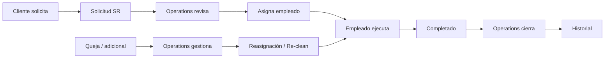
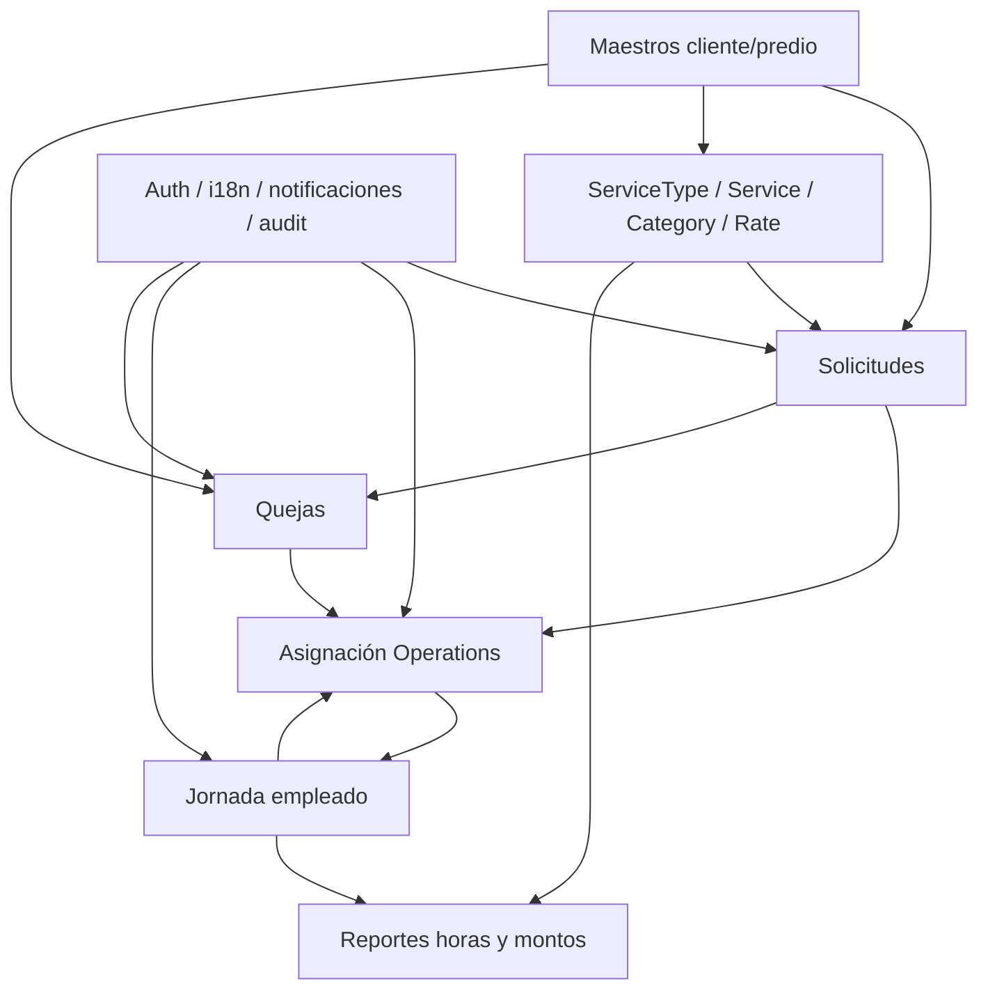

# Requerimientos funcionales — operación de limpieza (Castivas Cleaning)

**Based on:** [`1. Flujo Actual y Oportunidades.md`](1.%20Flujo%20Actual%20y%20Oportunidades.md) (reunión 8 oct 2026 + Formularios 1–4 + mapa portal).  
**Status:** draft — pending client validation  
**Base de producto:** workspace Limpieza (Django/DRF: `users`, `notifications`, `audit`, `core`; Vue: auth, shell, i18n ES/EN). C4 aún en stub; no hay módulos de dominio de limpieza todavía.

---

## 1. Contexto y objetivo

Castivas Cleaning (~150 empleados; Manhattan / Long Island / parte de NJ) opera hoy con **Trello** (programación), **Workforce** (tiempo en sitio), **Excel** (resto) y **QuickBooks** (contabilidad, se mantiene). Los formularios recibidos modelan solicitud, asignación (María/Operations), ejecución del empleado y quejas sobre una jerarquía Cliente → Propiedad → Edificio → Unidad.

**Objetivos del producto** (mapeo a oportunidades del as-is):

| Objetivo | Oportunidad |
|----------|-------------|
| Una sola fuente de solicitud + asignación + estado | O1 |
| Permanencia y evidencias ligadas al servicio (dejar Workforce) | O2 |
| Maestro cliente / predios con historial | O3 |
| Catálogo Service type/Service + Property category + Rate (precio y beneficio) en el MVP | decisión de producto / tarifas reunión |
| Ciclo de queja / re-clean trazable | O4 |
| Sugerencia de empleados con override manual | O8 |
| (Fases posteriores) inventario; puente a QuickBooks; supervisión | O5, O6, O7 |

No se reconstruye autenticación, notificaciones base ni preferencia de idioma: ya existen en el starter y se **reutilizan / extienden**.

---

## 2. Alcance

### Incluye

1. **Una sola plataforma web responsive** para cliente (property management / compañía), Operations y empleado de campo (uso en teléfono del empleado vía navegador; ver §2.2).
2. Roles: Cliente (contactos), Operations, Empleado, Supervisor (mínimo en fase 2), Administrador de sistema.
3. Maestro **Cliente → Propiedad → Edificio → Apartamento/Unidad** con área, habitaciones, baños, vacío y **categoría de propiedad**.
4. Catálogo **Service type → Service**, **Property category** y tabla **Rate** (precio cliente + beneficio empleado); ver §2.1.
5. **Solicitud de servicio** con campos del Formulario 1, elección de **Service** (no solo tipo), y **snapshot** de precio/beneficio desde Rate al crear/asignar.
6. Cola de **Operations**: revisar, corregir, asignar/reasignar, notas internas, notificar empleado (Formulario 2).
7. **Sugerencia** de empleados por disponibilidad / cercanía / carga (y override manual).
8. Jornada del empleado ligada al número de servicio: aceptar/rechazar, en camino, llegada, clock in/out, break, notas, fotos, finalizar (Formulario 3); **GPS puntual** al marcar hitos (no geofence continuo; ver §2.2).
9. **Quejas / solicitudes adicionales / re-clean** con vínculo opcional a `SR-######` (Formulario 4).
10. Historial y trazabilidad de solicitud → asignación → ejecución → cierre (y rama de queja).
11. **Tabla de servicios** (pasados y programados) con propiedad/unidad, Service, empleado, fechas, estado y montos según rol — ver RF-REP-3.
12. Notificaciones in-app (y email donde aplique) al asignar, reasignar, urgencias y resolución de queja.
13. UI en **inglés y español** con preferencia recordada por usuario.
14. Reportes operativos básicos: servicios por estado/fecha; horas por empleado; **montos** de precio cliente y beneficio empleado tomados del snapshot del SR (insumo a liquidación; el producto no ejecuta la nómina ni el cobro bancario).

### No incluye

| Fuera de alcance | Por qué / referencia as-is |
|------------------|----------------------------|
| Pasarela de pago / cobro online | No hablada con Castivas; as-is §10 y “no priorizar” |
| Reemplazar QuickBooks | Solo eventual envío de datos (fase posterior); as-is §10, O6 |
| App nativa iOS/Android (cliente o empleado) | Ver §2.2 — fuera de la oferta inicial |
| PWA empaquetada / “instalar app” como entregable aparte | Ver §2.2 — el valor está en el flujo web, no en el instalable |
| Geofencing continuo en segundo plano | Requiere app nativa; no aporta al MVP frente a GPS al clock in/out |
| Claim tipo Uber (“quién coge el trabajo”) | Asignación queda en Operations; as-is “no priorizar” |
| Inventario de insumos (stock empresa / por persona) | O5; sin detalle en formularios — Fase 3 |
| Flujo aparte de “cotización PDF” desligado del SR | El MVP muestra/ fijar precio desde Rate al solicitar; no un módulo de quotes independiente |
| Legalización fiscal ante EE.UU. fuera de QuickBooks | Explícito en reunión |
| Procurement / compras a proveedores | No recorrido |
| Depositar / pagar la nómina en banco | El MVP calcula **beneficio empleado** vía Rate; el pago bancario sigue fuera |

### 2.1 Modelo conceptual

| Pregunta | Respuesta para este producto |
|----------|------------------------------|
| ¿Cuál es el registro núcleo? | La **solicitud / servicio** (`SR-######`): une cliente, unidad, **Service**, ventana horaria, asignación, jornada, snapshot de Rate y cierre |
| ¿Qué no es? | No es un ticket genérico de helpdesk; no es una factura QuickBooks; no es un fichaje Workforce desligado del predio |
| ¿Dónde empieza el producto? | Cuando el **cliente envía una solicitud** (o Operations la crea en su nombre) sobre una unidad conocida o capturada |
| ¿Dónde termina el flujo feliz? | Cuando Operations **cierra** el servicio completado y el cliente puede ver el estado (y opcionalmente abrir queja/re-clean) |

#### Catálogo y precios (MVP)

```text
ServiceType          agrupación (Regular Cleaning, Carpet Cleaning, Move-Out, …)
  └── Service        ítem vendible (lo que se elige en el SR)

PropertyCategory     banda de predio (p. ej. por área + baños [+ habitaciones])
  └── Unidad         tiene o deriva una categoría

Rate                 (PropertyCategory × Service) → client_price + employee_benefit
                     (categoría opcional/N/A si el Service se diferencia por otra característica,
                      p. ej. bandas de área de alfombra bajo tipo Carpet Cleaning)
```

| Concepto | Rol |
|----------|-----|
| **Service type** | Agrupa para UX y reportes; seed inicial ≈ valores del Form. 1 |
| **Service** | Lo que se vende y se tarifica (p. ej. «Carpet ≤ 200 sq ft») |
| **Property category** | Cómo se banda la unidad para limpiezas que escalan con el predio |
| **Rate** | Precio al cliente y beneficio al empleado para un par categoría×servicio |

Al crear el SR se **congela un snapshot** de `client_price` y `employee_benefit` (y referencias a Service / categoría usadas), para que un cambio posterior de la tabla Rate no reescriba la historia.

### 2.2 Decisión de oferta: sin app (nativa / PWA) en la fase inicial

La **oferta inicial** entrega una **plataforma web única y responsive**, no una aplicación móvil nativa ni un entregable tipo “app / PWA instalable” para cliente o empleado.

#### Qué sí se ofrece

| Rol | Canal en la oferta inicial |
|-----|----------------------------|
| Cliente | Portal web (escritorio o móvil en el navegador) |
| Operations | Mismo portal web |
| Empleado | Mismas pantallas web, **diseñadas mobile-first** (abrir en el teléfono al llegar al predio) |

#### Qué no se incluye en la oferta inicial

- Apps **nativas** iOS / Android (App Store / Play Store).  
- Empaquetar o mantener una **PWA** como producto aparte (icono en home, service worker, push nativo, etc.).  
- **Geofencing continuo** (“avisar solo por entrar al radio” con la app cerrada).  

Eso puede reabrirse después del piloto si Operations demuestra un problema que el web no resuelve.

#### Por qué no aporta (casi) una app al cliente

- El cliente usa el sistema de forma **esporádica**: pedir servicio, ver estado, reportar queja.  
- Eso encaja en un **portal web**; instalar una app no mejora el flujo y sí suma fricción de adopción (property managers no vivirán en la app).  
- La propia reunión de kickoff ya cuestionó el valor de una app de cliente frente a la web.  
- El mapa “PORTAL WEB — Plataforma Castivas” describe portal, no tiendas de aplicaciones.

#### Por qué tampoco priorizamos app (ni PWA) para el empleado en la oferta inicial

Lo que el empleado necesita para reemplazar Workforce/Trello es:

1. Ver el servicio asignado  
2. Aceptar / rechazar  
3. Clock in / out + fotos / notas  

Eso se cubre con **web en el móvil**. Una app nativa solo se justifica de verdad si hace falta:

- ubicación en **segundo plano**,  
- geofence que dispare solo,  
- o trabajo **offline** fuerte.  

Ninguno de esos es el dolor principal del as-is (desfase Trello + liquidación Workforce + Excel). Empujar “app de empleado” en la oferta inicial encarece alcance (stores, firmas, versiones, dispositivos) sin atacar ese dolor.

#### GPS / “geofence” sin app

| Necesidad | Con web (oferta inicial) | Con app nativa |
|-----------|--------------------------|----------------|
| ¿Estaba cerca al hacer clock in/out? | Pedir ubicación **en el momento del tap** y comparar con el radio de la propiedad | Igual o mejor |
| Rastreo continuo / “en camino” automático | No fiable (sobre todo iOS con el navegador en segundo plano) | Sí |
| Bloquear clock in fuera de zona | Posible como **regla de negocio** sobre el punto GPS del tap; no requiere app | Igual |

**Posición de producto:** en MVP, GPS **puntual** al marcar llegada / clock in / clock out; flag “dentro / fuera del radio” para Operations; **sin bloqueo duro** salvo que Castivas lo pida después. Eso cubre evidencia operativa sin app.

#### Mensaje comercial (resumen)

> La oferta inicial es un **sistema web** (cliente + Operations + empleado en el teléfono). No incluye apps de tienda ni PWA como entregable. El valor está en unificar solicitud, asignación, evidencias y horas; no en instalar otra aplicación.



---

## 3. Flujo operativo de punta a punta

1. **Cliente** inicia sesión (o Operations carga la solicitud) y elige/alta propiedad → edificio → unidad.  
2. Completa tipo de servicio, habitaciones/baños/vacío, fecha/hora, rigidéz de horario, modo de acceso, prioridad, instrucciones y adjuntos opcionales → **Enviar** → se genera `SR-######`.  
3. **Operations** ve la solicitud, corrige datos si hace falta, consulta **empleados sugeridos**, asigna (o override), guarda notas internas → **notifica** al empleado.  
4. **Empleado** recibe notificación, ve detalle, **acepta o rechaza**; si acepta: en camino → llegada → clock in (+ GPS) → (break) → trabajo + fotos/notas → clock out → finaliza (completado sí/no).  
5. **Operations** revisa el servicio completado (evidencias, horas) y **cierra**; el cliente ve estado actualizado.  
6. Si hay problema: **Cliente** reporta queja/adicional/re-clean (Form. 4) → Operations gestiona → nueva asignación o re-clean → pasos 4–5.  
7. (Fase 2+) **Supervisor** registra visita/calificación sobre un servicio en curso o cerrado.

---

## 4. Requisitos por módulo

Convención: cada RF cita origen (`as-is §`, Form. N, O#). Criterios de aceptación son observables.

### 4.0 Plataforma existente (no re-inventar)

| Capacidad | Estado en base | Uso en Castivas |
|-----------|----------------|-----------------|
| Login / sesión / reset password | Front + `users` + allauth | Acceso Cliente, Operations, Empleado, Admin |
| Preferencia idioma ES/EN | `useAuthLocale` (localStorage) | Extender a toda la app; recordar por usuario |
| Notificaciones in-app + email hooks | app `notifications` | Nuevos `event_type` de asignación, rechazo, urgencia, queja resuelta |
| Auditoría de cambios | app `audit` | Trazar cambios de estado de `SR` y asignaciones |
| API DRF + Vue shell | Existe | Nuevos recursos de dominio |

**RF-PLAT-1.** El producto usa la autenticación existente (correo + contraseña). No se exige Google/SSO en MVP.  
*Origen:* reunión (correo/contraseña).  
*Aceptación:* un usuario de cada rol puede iniciar sesión y ver solo menús de su rol.

**RF-PLAT-2.** Toda la UI de usuario final está en ES y EN; el sistema recuerda la última preferencia del usuario.  
*Origen:* as-is §0 idiomas.  
*Aceptación:* cambiar idioma, cerrar sesión, volver a entrar → se mantiene el idioma elegido.

**RF-PLAT-3.** Al asignar o reasignar un servicio, el empleado recibe notificación in-app (email configurable).  
*Origen:* Form. 2; mapa portal; reutilizar `notifications`.  
*Aceptación:* tras “Guardar y notificar”, el empleado ve la notificación con enlace al `SR`.

---

### 4.1 Maestros: clientes, predios, catálogo y tarifas (O3 + decisión de producto)

**Datos mínimos**

- Cliente (compañía): nombre, contactos (nombre, email, teléfono).  
- Propiedad → Edificio → Apartamento/Unidad: área, habitaciones, baños, vacío; **Property category** (asignada o derivada por reglas).  
- **Service type** → **Service** (activo/inactivo; Services bajo tipos tipo Carpet usan bandas u otras características).  
- **Property category**: nombre + reglas de bandas (p. ej. área y baños); editable por Operations.  
- **Rate**: fila `(property_category | null, service)` → `client_price`, `employee_benefit` (moneda acordada, p. ej. USD).

**RF-MAES-1.** Operations puede crear y editar la jerarquía Cliente → Propiedad → Edificio → Unidad.  
*Origen:* as-is §1, Form. 1.  
*Aceptación:* dado cliente ABC, se crean propiedad, edificio 5 y unidad 215 y aparecen en selectores del Form. 1.

**RF-MAES-2.** El cliente autenticado solo ve y opera sobre sus propias propiedades/unidades.  
*Origen:* Form. 1 (listas de propiedad del cliente).  
*Aceptación:* usuario de cliente A no lista unidades de cliente B.

**RF-MAES-3.** Operations mantiene **Service types** y **Services**; el seed inicial cubre los tipos del Form. 1; un Service tipo “Other” / genérico puede exigir texto libre en el SR.  
*Origen:* Form. 1 §catálogo; decisión Service type + Service.  
*Aceptación:* se puede crear tipo «Carpet Cleaning» con varios Services por banda de área; el cliente/Operations elige un Service concreto en el SR.

**RF-MAES-4.** Operations mantiene **Property categories** y reglas para clasificar unidades (como mínimo área y número de baños; habitaciones opcionales). La unidad muestra su categoría.  
*Origen:* reunión tarifas por características; decisión de producto.  
*Aceptación:* al guardar una unidad con área/baños que caen en una banda, queda asociada a esa categoría (o Operations la asigna manualmente).

**RF-MAES-5.** Operations mantiene la tabla **Rate** (categoría × Service → precio cliente + beneficio empleado). Se permiten Rates con categoría vacía/N/A para Services que no dependen del predio (p. ej. bandas de alfombra).  
*Origen:* decisión de producto (pago por producto + cobro al cliente).  
*Aceptación:* para un Service de limpieza regular y categoría B existen ambos montos; al cambiar la Rate, los SR ya creados **no** cambian (snapshot).

---

### 4.2 Solicitudes de servicio — Cliente (O1, Form. 1)

**Datos:** campos del Form. 1 (cliente/contacto si aplica, **Service** (+ type implícito), ubicación, características de unidad, fecha/hora, rigidéz, acceso + instrucciones, prioridad Normal/Urgente/Emergencia, adjuntos ≤ 10 MB, confirmación) + snapshot de Rate.

**RF-SOL-1.** El cliente puede crear una solicitud completa eligiendo un **Service** y obtener un número `SR-######`.  
*Origen:* Form. 1; mapa portal pasos cliente.  
*Aceptación:* envío válido genera SR visible para Operations en estado “nueva / pendiente de revisión”.

**RF-SOL-2.** Prioridad Urgente/Emergencia queda marcada de forma visible en la cola de Operations.  
*Origen:* Form. 1 prioridad; mapa “urgent alerts”.  
*Aceptación:* filtro o badge distingue Normal vs Urgente/Emergencia.

**RF-SOL-3.** El cliente puede consultar el estado de sus solicitudes/servicios.  
*Origen:* mapa portal paso 10.  
*Aceptación:* tras asignación y cierre, el cliente ve estados actualizados sin llamar a Operations.

**RF-SOL-4.** Operations puede crear una solicitud en nombre del cliente (mismo modelo de datos).  
*Origen:* reunión (canal actual puede no ser portal); mapa admin.  
*Aceptación:* SR creada por Operations aparece en historial del cliente.

**RF-SOL-5.** Al crear (o confirmar) el SR, el sistema resuelve la Rate aplicable (categoría de la unidad + Service, o Service con categoría N/A) y guarda **snapshot** de `client_price` y `employee_benefit`. Si no hay Rate, Operations debe completarla antes de asignar (o se bloquea el envío — configurable; default: bloquear si falta Rate).  
*Origen:* §2.1 catálogo y precios.  
*Aceptación:* SR de «Regular Cleaning» en unidad categoría B muestra el precio al cliente; el beneficio empleado queda visible para Operations (y opcionalmente para el empleado).

**Default para estimación:** canal principal = portal web; captura telefónica la hace Operations (RF-SOL-4).

---

### 4.3 Operations — revisión y asignación (O1, O8, Form. 2)

**Datos:** número SR, timestamps, cliente/contacto, detalle heredado, empleado asignado, fecha/hora de asignación, notas internas, estado.

**RF-OPS-1.** Operations ve cola de solicitudes, puede editar datos de la solicitud antes de asignar.  
*Origen:* Form. 2; mapa flujo admin 1–3.  
*Aceptación:* corrección de unidad o hora queda auditada y visible al empleado.

**RF-OPS-2.** El sistema sugiere empleados candidatos (disponibilidad, distancia/zona, carga) y Operations elige uno (override libre).  
*Origen:* Form. 2 sugerencias; O8.  
*Aceptación:* con ≥2 empleados elegibles, la UI muestra lista ordenada y permite asignar a uno no sugerido.

**RF-OPS-3.** Al guardar asignación, estado pasa a “Asignado” y se notifica al empleado (RF-PLAT-3).  
*Origen:* Form. 2 acción.  
*Aceptación:* empleado ve el SR en “Mis servicios”.

**RF-OPS-4.** Operations puede reasignar un servicio no finalizado; queda historial del empleado anterior.  
*Origen:* mapa “asignar / reasignar”; as-is dependencia asignación.  
*Aceptación:* tras reasignar, el nuevo empleado es notificado y el anterior deja de verlo como activo.

**RF-OPS-5.** Operations cierra el servicio tras revisión de evidencias/horas.  
*Origen:* mapa flujo admin 8–9.  
*Aceptación:* solo servicios en “Completado” (o equivalente) pueden cerrarse; el cliente ve cerrado.

---

### 4.4 Empleado — jornada y evidencias (O2, Form. 3)

**Datos / hitos:** aceptar/rechazar, en camino, llegada, clock in, break, reanudar, clock out, estado, notas, fotos (antes/durante/después), completado sí/no, comentarios, coordenadas GPS en hitos.

**RF-EMP-1.** El empleado ve calendario/lista de servicios asignados con ubicación y detalle.  
*Origen:* Form. 3; mapa “Mis servicios”.  
*Aceptación:* solo ve los suyos.

**RF-EMP-2.** El empleado puede **aceptar o rechazar** una asignación; el rechazo notifica a Operations.  
*Origen:* Form. 3; mapa; pregunta abierta 4 (default producto = sí hay aceptación).  
*Aceptación:* rechazo deja el SR en estado que Operations debe reasignar.

**RF-EMP-3.** La secuencia de jornada registra timestamps (y GPS cuando el dispositivo lo permita) en clock in/out y llegada.  
*Origen:* Form. 3; O2 reemplazo Workforce.  
*Aceptación:* al finalizar, Operations ve hora de clock in, clock out y duración calculada.

**RF-EMP-4.** El empleado adjunta fotos (límite razonable, p. ej. 10) y notas antes de finalizar.  
*Origen:* Form. 3; reunión evidencias baño/cocina/cuarto.  
*Aceptación:* servicio finalizado sin fotos permitidas solo si Operations/política lo permite; por defecto se exige ≥1 foto al completar “Sí”.

**RF-EMP-5.** Al marcar llegada / clock in / clock out, el navegador puede capturar un punto GPS (si el usuario lo permite) y el sistema indica si está dentro del radio configurado de la propiedad/unidad. No hay geofence en segundo plano (§2.2).  
*Origen:* Form. 3 “Dentro del geofence”; decisión de oferta §2.2.  
*Default estimación:* advertencia si está fuera; no bloqueo duro en MVP (configurable).  
*Aceptación:* Operations ve flag dentro/fuera (o “GPS no disponible”) en el cierre.

**RF-EMP-6.** Break/lunch opcional pausa el tiempo contabilizado según regla simple (tiempo en break no suma a horas trabajadas del SR).  
*Origen:* Form. 3.  
*Aceptación:* con break de 30 min, duración neta = clock out − clock in − 30 min.

---

### 4.5 Quejas e incidencias (O4, Form. 4)

**Datos:** tipo (Queja incompleto, Daño, Problemas de acceso, Solicitud adicional, Re-Clean/Revisión, Otro), descripción, fotos, prioridad, SR relacionado opcional, unidad, flag “avisarme al resolver”.

**RF-QUE-1.** El cliente crea una incidencia ligada opcionalmente a un SR y obligatoriamente a una unidad.  
*Origen:* Form. 4.  
*Aceptación:* incidencia sin unidad es rechazada; con SR se muestra el servicio original.

**RF-QUE-2.** Operations gestiona la incidencia: puede crear/ligar un re-clean o reasignar servicio y cerrar la incidencia.  
*Origen:* as-is §5; mapa flujo queja.  
*Aceptación:* al cerrar, si el cliente pidió confirmación, recibe notificación.

**RF-QUE-3.** “Re-Clean / Complaint” como tipo de servicio y como tipo de incidencia quedan relacionados en historial de la unidad.  
*Origen:* Form. 1 + Form. 4.  
*Aceptación:* desde la unidad se listan SR y quejas en orden temporal.

---

### 4.6 Dashboard y reportes (mapa portal; reunión)

**RF-REP-1.** Operations tiene un tablero con conteos de solicitudes por estado y por prioridad.  
*Origen:* mapa módulos Dashboard/Reportes.  
*Aceptación:* filtros por rango de fechas.

**RF-REP-2.** Reporte por empleado y por SR exportable (CSV/Excel) con horas netas y **beneficio empleado** (snapshot), más precio cliente, para liquidación/cobro manual.  
*Origen:* O2; Rate §2.1; as-is liquidación “el 15 le pago X”.  
*Aceptación:* export de SR cerrados del período suma horas y beneficios alineados a los snapshots; no ejecuta pago bancario.

**RF-REP-3.** Existe una **tabla / listado de servicios** (SR) — pasados y futuros/programados — con al menos: número SR, propiedad/unidad, Service (y type), empleado asignado (si hay), fecha/hora programada, estado, y montos del snapshot según visibilidad del rol. Filtros mínimos: rango de fechas, estado, propiedad, Service, empleado (este último solo donde el rol lo permita).

Visibilidad por rol (obligatoria):

| Rol | Filas visibles |
|-----|----------------|
| **Admin / Operations** | Todas las solicitudes/servicios |
| **Empleado** | Solo SR donde es (o fue) el empleado asignado — prestados y programados |
| **Cliente** | Solo SR de **sus** propiedades/unidades — pasados y futuros |

Columnas sensibles (default):

| Rol | Precio cliente (`client_price`) | Beneficio empleado (`employee_benefit`) |
|-----|----------------------------------|-----------------------------------------|
| Admin / Operations | Sí | Sí |
| Cliente | Sí | No |
| Empleado | No | Sí |

*Origen:* O3 historial; reunión dashboard; decisión de producto.  
*Aceptación:* (1) Admin ve un SR de cualquier cliente; (2) empleado A no ve SR de empleado B; (3) cliente X no ve SR de propiedades de cliente Y; (4) un SR programado a futuro aparece en la lista del cliente dueño y del empleado asignado.

---


### 4.7 Supervisión (O7) — fase posterior

**RF-SUP-1 (fase 2).** Supervisor registra visita a un SR con calificación de predio/empleado y comentario/fotos.  
*Origen:* as-is §11; mapa Supervisores.  
*Bloqueo:* no hay formulario de campos; validar con cliente antes de estimar detalle.

---

### 4.8 Inventario (O5) — fase posterior

**RF-INV-1 (fase 3).** Control de insumos a nivel empresa y entregas por empleado, con señal de recompra.  
*Origen:* as-is §9; pregunta abierta 8.  
*Bloqueo:* faltan tipos de insumo, unidades de medida y umbrales.

---

### 4.9 Facturación e integración QuickBooks (O6) — fase posterior

Los **montos por SR** (precio cliente / beneficio empleado) ya viven en el MVP vía Rate + snapshot. Fase 3 añade integración contable.

**RF-QB-1 (fase 3).** Vista/historial de cobro al cliente consolidado y estados de facturación hacia contabilidad; **no** reemplaza QuickBooks.  
*Origen:* as-is §10.  

**RF-QB-2 (fase 3).** Exportación o API hacia QuickBooks de servicios cerrados (usando snapshots de precio).  
*Origen:* reunión “API QuickBooks”; O6.  
*Integración:* Castivas/Oceanic define quién expone qué; no asumir push silencioso.

---

## 5. Dependencias entre módulos



- Sin maestros de unidad, no hay solicitud ni queja útiles.  
- Sin Service + Rate aplicable, el SR no puede cotizar/congelar montos (RF-SOL-5).  
- Sin asignación, el empleado no tiene jornada.  
- Reportes de horas/montos dependen del cierre de jornada y del snapshot.  
- QuickBooks e inventario no bloquean el MVP.

---

## 6. Fases sugeridas

Solo la **fase 1** se denomina **MVP**. Las siguientes son **Fase 2** y **Fase 3**.

### MVP (fase 1) — Reemplazo operativo Trello + Workforce (dolor principal)

- Maestros cliente/predio + **Service type / Service / Property category / Rate**  
- Solicitud (cliente + Operations) con **Service** y **snapshot** de precio/beneficio  
- Asignación manual + notificación (lista de empleados disponibles; sugerencia avanzada = Fase 2)  
- Jornada empleado con clock in/out, fotos, aceptar/rechazar  
- Estados y cierre Operations  
- Queja/re-clean básica  
- i18n ES/EN + roles  
- **Tabla de servicios** con filtro por rol (RF-REP-3)  
- Reporte horas + montos (cliente / beneficio empleado) CSV  

**Éxito del MVP:** un SR real puede pedirse con precio según Rate, asignarse, ejecutarse con evidencias/horas y cerrarse **sin Trello ni Workforce**, con montos listos para liquidar/cobrar a mano; cada rol consulta su historial/agenda de servicios sin ver filas ajenas.

### Fase 2 — Calidad de asignación y campo

- Sugerencia de empleados (distancia/zona, carga, disponibilidad)  
- Mapa Operations con últimos puntos GPS de clock in/out (sigue siendo web)  
- Alertas urgentes / reasignación rápida  
- Supervisión (visita + calificación) si el cliente valida campos  
- Feedback del cliente (estrellas/comentarios del mapa) si lo confirman  
- *(Opcional, solo si el piloto lo pide)* PWA “Añadir a pantalla de inicio” — no nativa  

### Fase 3 — Contabilidad e insumos

- Historial/estados de facturación hacia contabilidad  
- Integración o exportación QuickBooks (desde snapshots del MVP)  
- Inventario empresa + por empleado  

---

## 7. Preguntas abiertas y decisiones pendientes (bloquean estimación)

| # | Tema | Impacto | Default si hay que estimar antes de respuesta |
|---|------|---------|-----------------------------------------------|
| 1 | Bandas exactas de Property category (cortes de área/baños) y lista inicial de Services (p. ej. carpet) | Datos seed Rate | Operations carga categorías/Services/Rates en configuración; producto trae tipos seed del Form. 1 |
| 2 | Cómo se cobra al cliente hoy; ¿pasarela? | RF-QB Fase 3 | Sin pasarela; MVP solo snapshot + reportes |
| 3 | Canal actual de solicitud (tel/WhatsApp/…) | Prioridad UX cliente vs Operations | Portal + carga por Operations |
| 4 | ¿Aceptar/rechazar es obligatorio hoy? | RF-EMP-2 | **Incluir** aceptar/rechazar como en Form. 3 |
| 5 | ¿GPS al fichar ya existe en Workforce? | Esfuerzo RF-EMP-5 | GPS puntual al clock in/out + flag radio; sin app (§2.2) |
| 6 | Formato actual de visitas de supervisor | RF-SUP-1 | Fuera del MVP (Fase 2) |
| 7 | Capacidad de Operations (personas/zonas) | Multiusuario, filtros por zona | Multi-usuario Operations sin restricción por zona en el MVP |
| 8 | Detalle de insumos | RF-INV | Fuera del MVP y Fase 2 (Fase 3) |
| 9 | ¿El empleado ve su `employee_benefit` en la app web? | UX RF-EMP | **Sí**, solo lectura del snapshot del SR |

**Decisiones de producto ya tomadas (no reabrir en estimación):**

- Idiomas ES + EN con preferencia recordada.  
- QuickBooks se integra después; no se reemplaza.  
- Sin pasarela de pago en alcance actual.  
- Asignación la hace Operations (no marketplace Uber).  
- **Oferta inicial = solo web responsive** (sin app nativa ni PWA como entregable); ver §2.2.  
- **Modelo de catálogo/precio en el MVP:** Service type → Service, Property category, Rate `(category × service) → client_price + employee_benefit`, con snapshot en el SR.  
- Pago al empleado en el MVP = **por Service (beneficio en Rate)**, no por hora (las horas se registran igual para control).  
- **Tabla de servicios (RF-REP-3):** Admin/Operations ven todo; empleado solo los suyos (hechos o programados); cliente solo los de sus propiedades (pasados o futuros).

---

## 8. Criterios de éxito de negocio

| Señal | Cómo se verifica |
|-------|------------------|
| Dejar de usar Trello para programar servicios del piloto | Operations trabaja solo en Limpieza durante N semanas |
| Dejar de usar Workforce para el piloto | Horas salen del SR (RF-REP-2) |
| Una sola fuente de verdad por unidad | Historial de SR + quejas en el maestro de unidad |
| Consulta de servicios prestados/programados por rol | RF-REP-3: admin todo; empleado los suyos; cliente sus propiedades |
| Quejas trazables | Cada queja del piloto tiene estado y, si aplica, SR de re-clean |
| Menos re-digitación | Solicitud del cliente no se vuelve a tipear en Excel para asignar |

Horas operativas semanales del as-is siguen **no medidas**; la validación cuantitativa de ahorro queda para piloto tras validar este documento.

---

## Trazabilidad rápida RF → as-is

| Módulo | Oportunidades | Formularios / §§ |
|--------|---------------|------------------|
| Maestros predios | O3 | §1, Form. 1 |
| Service type / Service / Category / Rate | O3 + cobro/liquidación | §2.1; reunión tarifas |
| Solicitudes | O1 | Form. 1, §2 |
| Operations / sugerencia | O1, O8 | Form. 2, §3, §7 |
| Empleado / jornada | O2 | Form. 3, §4, §8 |
| Quejas | O4 | Form. 4, §5 |
| Reportes horas y montos | O2 | §8 + Rate |
| Tabla servicios por rol | O3 | RF-REP-3 |
| Supervisión | O7 | §11 |
| Inventario | O5 | §9 |
| QuickBooks | O6 | §10 |
